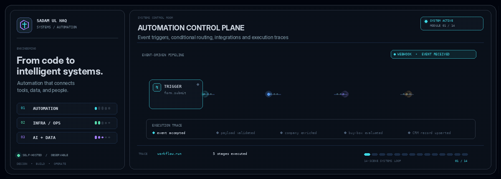

  

Full-width systems workflow simulation · detailed card annotations · light particles follow routed connectors · illustrative activity, not a live production feed.

  

  
  
  
  
  
  

---

## Hey, I'm Sadam 👋

I build practical software for startups and business owners: deal pipelines, operations tooling, automation, and self-hosted systems that small teams can run and maintain.

**Business problems first. Code and automation second.** I care about useful workflows, dependable systems, and keeping infrastructure understandable.

## Currently building

### 🛰️ Project Lantern
*A self-hosted control centre for managing application deployments.*

- Go backend and Svelte frontend, split across two repositories.
- Builds, quality gates, and deployments run locally (WSL) and on my VPS instead of relying entirely on hosted CI.
- Work is delivered in numbered, documented batches, each with its own report.

### 📇 Project Ledger
*A CRM and deal-tracking platform for acquisition teams.*

- Kanban deal pipeline, role-based access, and audit trails.
- Bulk CSV import with column mapping and batching, designed for large listing datasets.
- Fuzzy deduplication and criteria-based deal scoring.
- Per-user document storage through Google Drive OAuth.
- Exploring PocketBase and Supabase/PostgreSQL with row-level security for self-hosted deployment.

---

## Product ideas & business workflows

These are product concepts and areas I explore—not a claim that every item below is a finished, production-ready product.

<strong>📈 Sales & customers</strong>

| Concept | Purpose |
|---|---|
| **Beacon** | Capture inbound leads, enrich them, and score them by fit. |
| **Switchboard** | Shared inbox for email, WhatsApp, and website chat with assignment and SLAs. |
| **Quill** | Proposal and quote builder with e-signatures and payment links. |
| **Quota** | Sales targets, commission calculations, and rep leaderboards. |
| **Echo** | AI support assistant grounded in company documentation with human handoff. |

<strong>⚙️ Operations & back office</strong>

| Concept | Purpose |
|---|---|
| **Tally** | Invoicing, recurring billing, and payment reminders. |
| **Vault** | Secure client portal for document requests, uploads, and sign-offs. |
| **Roster** | HR onboarding, contracts, leave, and employee records for distributed teams. |
| **Payline** | Payroll preparation and multi-currency contractor-payment reconciliation. |
| **Shift** | Staff scheduling, clock-ins, and timesheets. |
| **Stockroom** | Inventory, purchase orders, and stock alerts. |
| **Dispatch** | Job booking, routing, and technician-facing mobile workflows. |

<strong>💰 Finance & deals</strong>

| Concept | Purpose |
|---|---|
| **Sieve** | Filter broker listings against acquisition criteria and flag matches. |
| **Diligence** | M&A data room with checklists, request tracking, and Q&A. |
| **Horizon** | Cash-flow forecasting from bank and accounting data. |
| **Captable** | Cap-table and SAFE tracking, dilution scenarios, and investor updates. |

<strong>🤖 AI & automation</strong>

| Concept | Purpose |
|---|---|
| **Scribe** | Turn meeting recordings into CRM notes and follow-up tasks. |
| **Parse** | Extract structured data from invoices, receipts, and contracts. |
| **Flowline** | Self-hosted workflow automation for connecting business tools. |
| **Murmur** | Monitor reviews and brand mentions with sentiment alerts. |

<strong>🧱 Infrastructure & platform</strong>

| Concept | Purpose |
|---|---|
| **Keystone** | Multi-tenant SaaS starter with authentication, billing, and roles. |
| **Bastion** | Automated backups and uptime monitoring for small-business servers. |
| **Prism** | Privacy-friendly, self-hosted product analytics. |

<strong>🏪 Industry tools</strong>

| Concept | Purpose |
|---|---|
| **Appoint** | Online booking, reminders, and no-show reduction. |
| **Tableside** | Restaurant reservations, QR menus, and table ordering. |
| **Keyring** | Rent collection, maintenance requests, and lease tracking. |
| **Campus** | Course hosting, cohorts, and learner progress tracking. |
| **Convoy** | Vehicle and delivery tracking with proof of delivery. |

---

## What I like working on

- **Self-hosting & operations:** Linux servers, SSH, deployment workflows, backups, and keeping services maintainable.
- **Data-heavy internal tools:** imports, deduplication, scoring, and pipelines.
- **Systems integration:** connecting platforms and APIs without creating fragile workflows.
- **AI-assisted development:** using coding agents with human review, tests, and clear quality gates.
- **Process automation:** deal, sales, HR, and operations workflows for distributed teams.

## Toolbox

`Go` · `Svelte` · `Python` · `PocketBase` · `Supabase` · `PostgreSQL` · `Linux` · `WSL` · `SSH` · `Git` · `Google APIs / Drive OAuth` · `ServiceNow` · `Oracle` · `n8n` · `Hermes Agent` · `Slack Automations`

## How I got here

IT support → systems integration → business development → sales workflows → AI research → M&A and business operations

---

## Work with me 📫

If your business process is held together by spreadsheets, repetitive admin, and copy-paste, I'd be glad to talk about how to make it more reliable.

  Build practical systems. Automate the repeatable. Keep the important things understandable.

